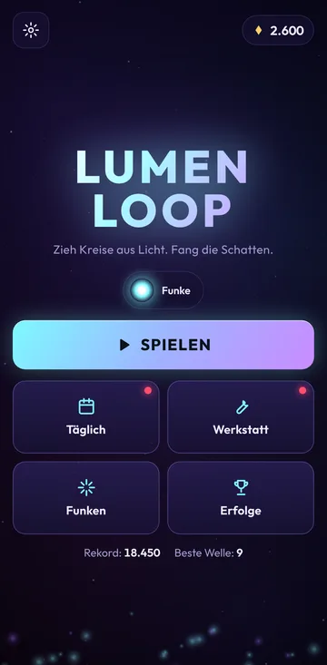
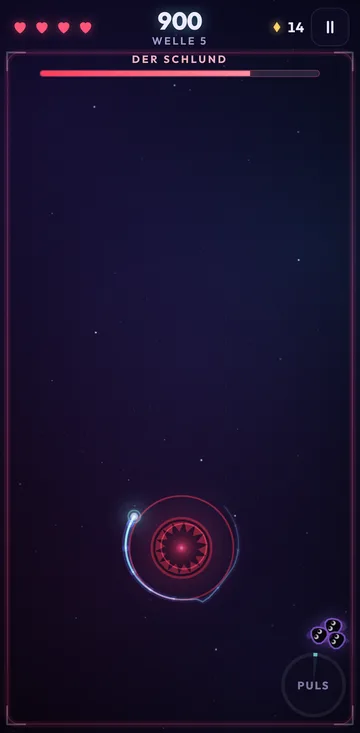
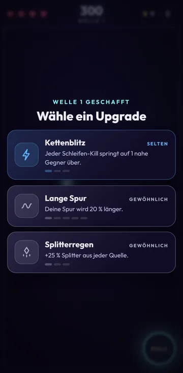
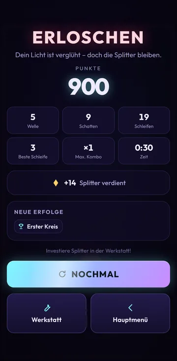

# LUMEN LOOP

**Zieh Kreise aus Licht. Fang die Schatten.**

LUMEN LOOP ist ein Arcade-Roguelite für das Handy, das man mit einem Daumen spielt. Du steuerst einen
Lichtfunken, der eine leuchtende Spur hinter sich herzieht. Kreuzt die Spur sich selbst, schließt sich eine
Schleife, und alle Schatten darin werden ausgelöscht. Je mehr Schatten in einer Schleife gefangen sind, desto höher fällt der Bonus aus.
Berührst du einen Schatten selbst, kostet das ein Herz.

<p align="center">
  
  
  
  
</p>

## Features

- **Kernmechanik „Schleife“** mit Multi-Kill- und Kombo-Multiplikatoren. Ein *magnetischer Schleifenschluss*
  verzeiht auf dem Touchscreen ein paar Pixel Ungenauigkeit.
- **Steuerung:** Der Funke schwebt in einstellbarem Abstand über dem Finger (am Rand wird der Abstand kleiner, damit jede Stelle erreichbar bleibt). Alternativ gibt es eine Trackpad-Steuerung, bei der der Finger irgendwo liegen kann.
- **12 Gegnertypen** (u. a. Wächter mit Schildaura, teleportierende Blinker, explodierende Bomber, Prellbälle und Geister) und **6 Bosse**:
  Schlund, Weberin, Zwillinge, Hydra, Auge und Wirbel. Alle fünf Wellen kommt ein Boss, mit jedem Durchgang stärker.
- **31 Upgrades** mit Synergien (davon 4 legendäre Fusionen), **10 Funken** (zwei Premium, einer exklusiv im Shop, der Sonnenkern ab Stufe 50) und **6 Gebiete** mit eigener Farbwelt.
- **Fortschritt:** Lichtstufen mit Stufenpfad (Funken, Upgrades und Werkstatt-Ränge werden bis Stufe 50 freigeschaltet), Etappen, 3 Tagesmissionen, 7-Tage-Bonus, Werkstatt mit 10 Verbesserungen, Booster, 35 Erfolge, tägliche Herausforderung, Wochen-Event mit Bronze/Silber/Gold.
- **Lichtpass:** 28-Tage-Saisons mit 30 Stufen, Gratis- und Premium-Belohnungen (`light_pass`, 4,99 €), dazu 7 Spur-Designs.
- **Kampagne:** 60 Level in 6 Welten mit festen Wellenplänen, Sonderregeln und einem Boss am Ende jeder Welt. Pro Level bis zu 3 Sterne (geschafft, höchstens ein Treffer, Punkteziel).
- **Modi:** Normal, Blitz (3 Minuten auf Punkte, ab Stufe 5) und Bossjagd (jede Welle ein Boss, ab Stufe 12).
- **Funken-Meisterschaft** (10 Stufen pro Funke, +1 % Punkte und Splitter pro Stufe) und **Freunde herausfordern** per Code (gleicher Lauf, gleicher Funke, ohne Booster).
- **Bewertung im Spiel:** Nach einem neuen Rekord fragt die App über Googles In-App-Review nach einer Bewertung (höchstens dreimal, mit 30 Tagen Abstand).
- **Wirtschaft:** Splitter (im Spiel verdient) und Diamanten (Etappen, Erfolge, Stufen, Missionen, Gratis-Werbung oder Kauf).
  Nach dem Tod kann man einmal pro Runde per Werbung weiterspielen (auch eine abgebrochene Werbung zählt), danach mit Splittern oder Diamanten.
- **Werbung & Käufe:** AdMob (Rewarded und Interstitials nur zwischen Runden, mit DSGVO-Einwilligung) und Google Play Billing.
  Im Browser wird beides als „Demo“ simuliert.
- **Grafik:** Canvas 2D plus ein eigener WebGL2-Filter: ein eigener Hintergrund pro Gebiet (Nebel, glühende Risse, Lichtnetze unter Wasser, Polarlichter, ein ferner Strudel, Kristalle), Licht von Funke und Spur, das die Umgebung erhellt, Bloom, Schockwellen-Verzerrung und Farbversatz bei Treffern. Schatten ziehen dunklen Rauch hinter sich her. Ohne WebGL2 oder auf langsamen Geräten läuft das Spiel mit der einfachen 2D-Grafik weiter.
- **Prozeduraler Sound:** Alle Effekte und die generative Musik (ein eigenes Thema pro Gebiet, härtere Akkorde bei Bossen) entstehen live mit der Web Audio API. Optional lassen sich echte Musikdateien einbinden, siehe [`docs/MUSIC.md`](docs/MUSIC.md).
- **Google Play Games:** Bestenlisten (auch im Spiel mit Top 10 und eigenem Platz), Erfolge und Cloud-Speicherstand. Ohne Einrichtung bleibt alles aus.
- **Mobile-Details:** Safe-Area/Notch, Auto-Pause, Bildschirm bleibt an, Zurück-Taste, automatische Grafikanpassung, offline spielbar.
- **Deutsch & Englisch** werden automatisch erkannt und lassen sich umschalten.

## Dokumente

| Dokument | Inhalt |
|---|---|
| [`docs/GAME_DESIGN.md`](docs/GAME_DESIGN.md) | Ursprünglicher Spielentwurf |
| [`docs/PLAY_STORE_PLAN.md`](docs/PLAY_STORE_PLAN.md) | Recherche + Plan für die Play-Version (Wirtschaft, Werbung, Käufe) |
| [`docs/PLAY_CONSOLE_CHECKLIST.md`](docs/PLAY_CONSOLE_CHECKLIST.md) | Schritt für Schritt zur Veröffentlichung |
| [`docs/PLAY_GAMES_SETUP.md`](docs/PLAY_GAMES_SETUP.md) | Google Play Games: Bestenlisten, Erfolge und Cloud-Speicherstand einrichten |
| [`docs/MUSIC.md`](docs/MUSIC.md) | Eigene Musikdateien einbinden |
| [`docs/store/LISTING.md`](docs/store/LISTING.md) | Store-Texte DE/EN, Feature-Grafik, Screenshots |
| [`android/README.md`](android/README.md) | App bauen, signieren, AdMob-IDs, Paketname |

## Spielen

Am Handy öffnest du die gehostete Seite (siehe unten) im Browser und wählst dann **„Zum Home-Bildschirm“**.
Danach startet LUMEN LOOP als Vollbild-App und funktioniert auch offline.

| Eingabe | Aktion |
|---|---|
| Finger ziehen | Funke bewegen (schwebt über dem Finger; Trackpad-Modus in den Einstellungen) |
| Doppeltippen / zweiter Finger / PULS-Button | Puls (Schockwelle, sobald aufgeladen) |
| Desktop: WASD/Pfeile · Leertaste · Esc | Bewegen · Puls · Pause |

## Entwicklung

```bash
npm install
npm run dev          # Dev-Server (auch im WLAN erreichbar → am Handy testen)
npm test             # 123 Unit-, Simulations- & Plattformtests (u. a. ein Bot, der 5 Bosse besiegt, und alle 60 Kampagnen-Level)
npm run build        # Produktions-Build nach dist/ (inkl. Service Worker)
npm run smoke        # Browser-Smoke-Test auf emuliertem Pixel 7 (benötigt den Build)
npm run build:single # Alles in einer einzigen HTML-Datei (dist-single/)
npm run icons        # App-Icons (Web + Android) neu erzeugen
npm run android:debug   # Android-Debug-APK bauen
npm run android:bundle  # Signiertes .aab für Google Play bauen
node scripts/store-assets.mjs  # Store-Grafiken & Screenshots neu erzeugen
```

**Veröffentlichen:** Der Workflow `.github/workflows/deploy.yml` baut bei jedem Push auf `main` und
veröffentlicht auf GitHub Pages. Dafür einmalig unter *Settings → Pages → Source* die Option **GitHub Actions** wählen.

## Architektur

Das Spiel ist in TypeScript mit Vite geschrieben, nutzt Canvas 2D, einen WebGL2-Nachbearbeitungsfilter, Web Audio und DOM-Overlays für Menüs und kommt ohne Engine aus (ca. 100 KB JS gzip).
Die Android-App ist eine Capacitor-8-Hülle (Ziel-API 36), siehe `android/`.

```
src/
  core/     Mathe, Geometrie, Seed-RNG, Spatial Hash, Spielstand (versioniert, robust), i18n
  economy/  Preise, Belohnungen, Missionen, Stufen, Etappen (reine, getestete Funktionen)
  platform/ Werbung, Käufe, Teilen, Bewertung, Play Games: Android und Browser-Demo
  game/     Headless-Simulation: World, Spur & Schleifenerkennung, Gegner, Bosse, Wellen,
            Upgrades, Funken, Meta, Modifikatoren, Erfolge
  render/   Renderer, Glow-Sprites, Hintergrund, Effekte, WebGL-Lichteffekte und Gebiets-Hintergründe (postfx.ts)
  audio/    Synthesizer-SFX und generative Musik
  ui/       Bildschirme, HUD, Icons, Styles
  app.ts    Zustandsautomat und Spielschleife (fester 60-Hz-Zeitschritt)
```

Die Simulation (`World`) kennt weder DOM noch Audio. Sie erzeugt nur Events. Dadurch ist sie vollständig testbar,
und ein Bot spielt in den Tests ganze Runden inklusive der ersten fünf Bosse.

Der vollständige Plan mit Design-Entscheidungen und Balancing steht in [`docs/GAME_DESIGN.md`](docs/GAME_DESIGN.md).
